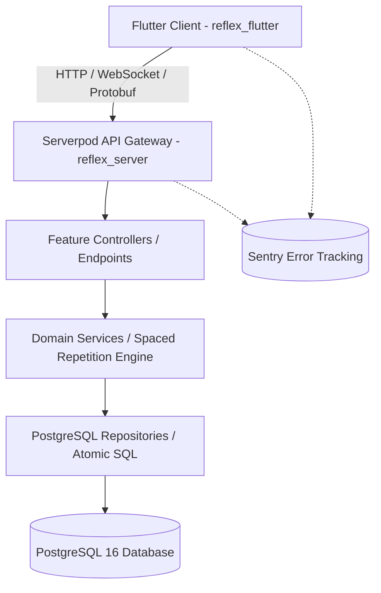

# Reflex Architecture Guide (ARCHITECTURE.md)

> Comprehensive technical blueprint and architectural specification for **Reflex** — Adaptive Spaced Repetition Learning Platform.

---

## 1. Architectural Overview & Philosophy

Reflex is designed around **Package-by-Feature (Screaming Architecture)** and the **Clean Architecture / MVVM** paradigm. The project separates business domain logic, presentation state, and data synchronization while preserving deterministic testing capabilities.



---

## 2. Monorepo Organization

```text
reflex/
├── reflex_client/             # Generated type-safe Dart client & DTOs
├── reflex_server/             # Serverpod backend application
│   ├── bin/                   # Server bootstrap
│   ├── config/                # Environment configs (development, test, production, passwords)
│   ├── lib/
│   │   ├── src/
│   │   │   ├── core/          # Cross-cutting configs (EnvLoader, Sentry, TimeProvider)
│   │   │   ├── features/      # Feature modules (auth, practice, questions, analytics, clock)
│   │   │   └── generated/     # Protocol buffers and Serverpod models
│   ├── migrations/            # Versioned PostgreSQL schema migrations
│   └── test/                  # Unit and integration test suites
├── reflex_flutter/            # Flutter cross-platform client (Web, iOS, Android, macOS)
│   ├── assets/                # Localization JSON dictionaries (en.json, ar.json)
│   ├── lib/
│   │   ├── presentation/      # UI Layer: Features, Screens, Theme, Shell
│   │   │   ├── core/          # App Theme, tokens, chromatic palette
│   │   │   ├── features/      # Auth, Practice, Analytics, Question Admin, Demo Clock
│   │   │   └── shell/         # AppShell with role-specific tab routing
│   │   └── generated/         # EasyLocalization code generation
│   └── web/                   # Web assets & auth.html for OAuth PKCE callback
├── tool/                      # Developer tooling & automated checks
│   ├── check.sh               # Complete verification pipeline (analyze + all tests)
│   └── smoke_test.dart        # End-to-end API smoke test runner
├── docker-compose.prod.yaml   # Production container stack (Postgres + Redis + Serverpod)
└── .env.example               # Environment variables template
```

---

## 3. Server Architecture (Serverpod 4.0)

### 3.1 Controller-Service-Repository Pattern
- **Endpoints (`EndpointPractice`, `EndpointAnalytics`, `EndpointQuestionAdmin`, `EndpointDemoClock`):** Handle protocol serialization, authentication validation, role scope verification (`AppScopes.student`, `AppScopes.teacher`), and parameter sanitization.
- **Services (`CardSelector`, `GradingEngine`, `AnalyticsService`):** Pure Dart business logic responsible for computing Leitner intervals, reflex tiers (Green / Yellow / Red), and topic aggregations.
- **Repositories & Atomic SQL:** Directly manages Postgres entity persistence.

### 3.2 Atomic PostgreSQL Counter Invariant
To eliminate race conditions and counter drift under high concurrent student load, Reflex employs atomic raw SQL execution rather than read-modify-write patterns:

```sql
UPDATE question SET
  attempt_count = attempt_count + 1,
  attempted_student_count = attempted_student_count + @is_new_student,
  solved_student_count = solved_student_count + @is_new_solve,
  first_try_solve_count = first_try_solve_count + @is_first_try,
  under_time_solve_count = under_time_solve_count + @is_under_time,
  clean_solve_count = clean_solve_count + @is_clean_solve
WHERE id = @question_id;
```

### 3.3 The 6 Performance Counters
1. `attemptCount`: Total attempts submitted across all students.
2. `attemptedStudentCount`: Unique students who have attempted this question.
3. `solvedStudentCount`: Unique students who have successfully solved this question.
4. `firstTrySolveCount`: Solves achieved on the student's very first encounter.
5. `underTimeSolveCount`: Solves achieved within the target `expectedSeconds`.
6. `cleanSolveCount`: **The Gold Standard (Clean-First-Try):** First attempt, correct, under target time, and zero hints requested.

---

## 4. Spaced Repetition & Adaptive Practice Engine

### 4.1 Card Selection Priority Queue
1. **Overdue Cards:** Cards where `nextReviewAt <= currentTime` (ordered by earliest review date).
2. **New Cards:** Unattempted cards ordered by curriculum position.
3. **Deck Complete:** Returns `null` when no cards are due.

### 4.2 Chromatic Aura & Feedback Tiers
- 🟢 **Mastered (Clean Solve):** Interval multiplied by 2.5x.
- 🟡 **Developing (Slow or Hint Used):** Interval advanced by 1.2x.
- 🔴 **Needs Work (Incorrect):** Interval reset to +1 day.

### 4.3 Mandatory Topic Note Gate
After submitting an answer, if the teacher has authored a `topicNote`, the student is required to review and acknowledge the conceptual explanation before advancing to the next card. This enforces cognitive consolidation.

---

## 5. Security, Secrets & Authentication

### 5.1 Environment Configuration (.env)
- Production and development secrets are loaded via zero-dependency [`EnvLoader`](lib/src/core/config/env_loader.dart).
- Sensitive files (`.env`, `config/passwords.yaml`) are protected in `.gitignore`.
- Template [`.env.example`](.env.example) guides developer configuration.

### 5.2 Google OAuth 2.0 PKCE Flow
- **Web:** Utilizes OAuth 2.0 PKCE redirection captured by `web/auth.html` via `window.postMessage`, forwarded to `GoogleIdpEndpoint.loginWithCode`.
- **Mobile/Desktop:** Uses native Google Sign-In SDK with ID token verification via `GoogleIdpEndpoint.login`.
- **Graceful Fallback:** If OAuth credentials are unconfigured during local demo/evaluation, the app notifies the user and proceeds seamlessly with persona profiles.

---

## 6. Frontend Architecture (Flutter MVVM)

- **Presentation Separation:** Views (`AuthScreen`, `PracticeScreen`, `StudentProgressScreen`, `AnalyticsScreen`, `QuestionAdminScreen`) bind to `ChangeNotifier` state controllers.
- **Adaptive Shell (`AppShell`):** Dispatches role-specific navigation:
  - **Student View:** Adaptive Practice & My Progress.
  - **Teacher View:** Cohort Analytics & Question Notes/Hints Admin.
- **Localization:** 100% Arabic and English localization with dynamic RTL/LTR directionality powered by `easy_localization`.
- **Material 3 Design:** Dynamic color tokens, chromatic state animations, and seamless dark/light theme switching.

---

## 7. Testing & Quality Assurance

Reflex maintains a strict **Zero-Defect Standard**:
- **76 Backend Tests:** Unit and integration tests executing real SQL against a Postgres test database.
- **15 Frontend Tests:** Widget and behavioral tests verifying English/Arabic rendering, RTL layouts, note gates, and role switching.
- **E2E Smoke Test (`tool/smoke_test.dart`):** Verifies full backend lifecycle against live endpoints.
- **CI Verification Script (`tool/check.sh`):** Single-command validation enforcing 0 analyzer warnings and 100% test pass rate.
