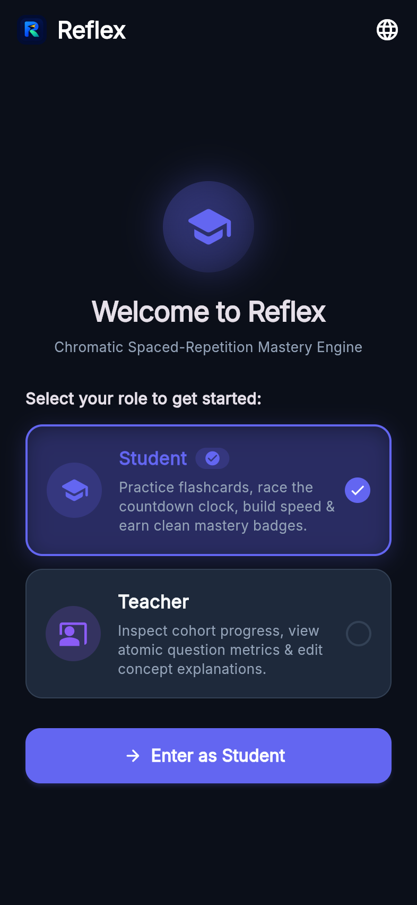
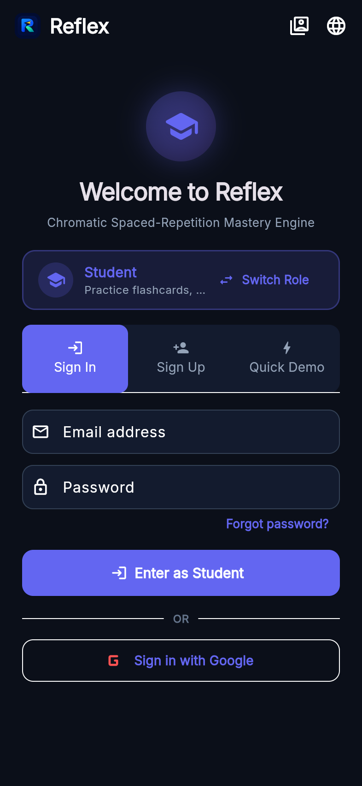
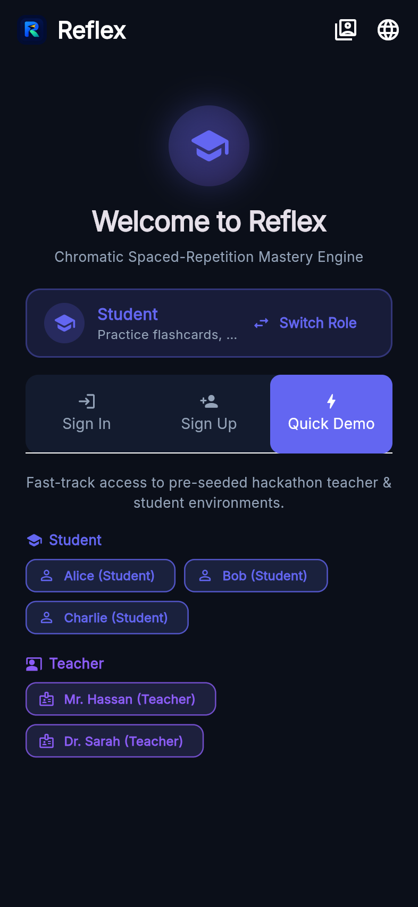
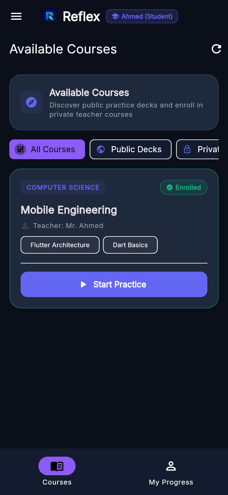
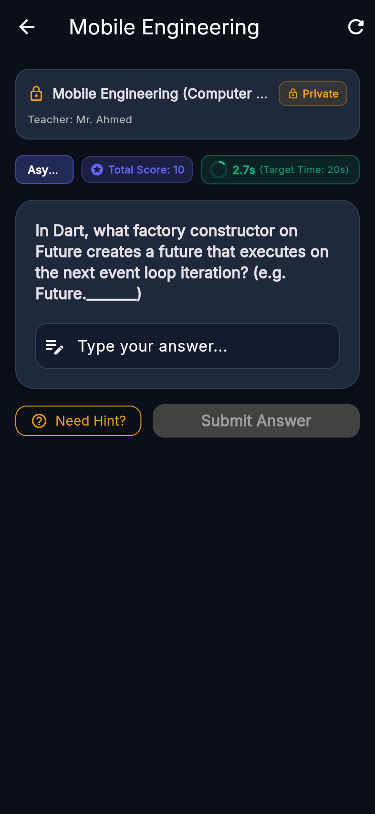
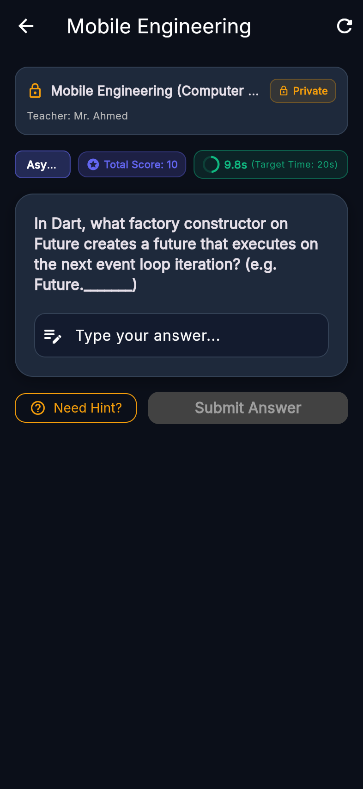
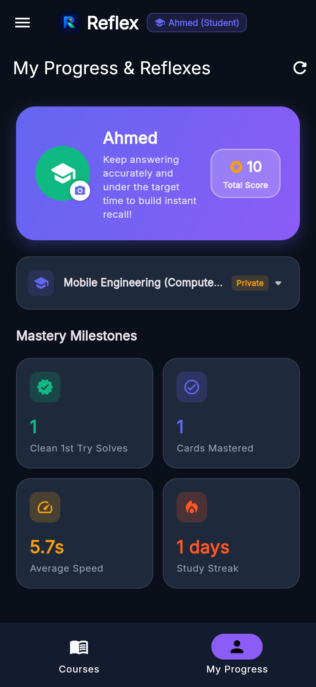
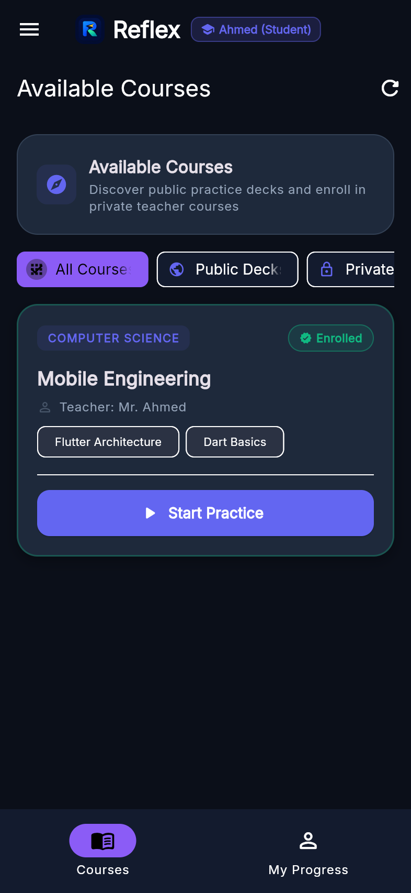

# Reflex ⚡

> **Reflex** is a high-performance, adaptive spaced-repetition learning platform built with **Serverpod** (PostgreSQL) and **Flutter**. It combines rapid-recall card drills, chromatic performance feedback, live peer statistics, and teacher-authored concept mastery explanations.

---

## ☁️ Live Demo & Deployment

Reflex is deployed and running live on **Serverpod Cloud**:

| Service | Public URL | Description |
| :--- | :--- | :--- |
| 🌐 **Live Web App** | [https://reflex.serverpod.space/](https://reflex.serverpod.space/) | Deployed Flutter Web client |
| ⚡ **API Server** | [https://reflex.api.serverpod.space/](https://reflex.api.serverpod.space/) | Live Serverpod backend API |
| 📊 **Serverpod Insights** | [https://reflex.insights.serverpod.space/](https://reflex.insights.serverpod.space/) | Serverpod Insights dashboard |

## 🔑 Test Credentials

Use these pre-configured accounts to explore the live app directly against the production backend:

| Role | Email | Password | What to explore |
| :--- | :--- | :--- | :--- |
| 👩‍🏫 **Teacher** | `ah3656056@gmail.com` | `12345678` | Course admin, question editor, subscription manager, cohort analytics |
| 🎓 **Student** | `ahmedhassan.op9@gmail.com` | `12345678` | Speed-recall drills, chromatic feedback, compulsory concept notes, study streaks |

> 💡 **Quick Start:** On the role selection screen, pick **Teacher** or **Student** to match your chosen persona, then sign in with the credentials above (or tap any of the demo persona buttons on the auth screen).

---

## 📱 App Tour & Mobile Screenshots

Reflex is designed mobile-first with high-fidelity dark aesthetics, micro-animations, and instant chromatic feedback.

### 🎓 Student Experience & Speed-Recall Practice

| 1. Role Selection | 2. Authentication | 3. Quick Demo Personas |
| :---: | :---: | :---: |
|  |  |  |
| Choose Student or Teacher | Sign in with email or OAuth | One-tap judge & demo logins |

| 4. Courses Dashboard | 5. MCQ Flashcard Drill | 6. Option Selection |
| :---: | :---: | :---: |
|  |  |  |
| Enrolled courses & active tags | 30s countdown & hint trigger | Real-time option highlight |

| 7. 🟢 Chromatic Feedback (Mastered) | 8. Text-Input Question Drill | 9. Student Progress & Streaks |
| :---: | :---: | :---: |
|  |  |  |
| Emerald green aura + rationales | Text answer with auto-grading | Mastery milestones & streaks |

### 👩‍🏫 Teacher Analytics & Management Portal

| 10. Topic Mastery Breakdown | 11. Question Insights (Atomic Counters) |
| :---: | :---: |
|  |  |
| Live student counts, progress bars, and clean solve metrics | Atomic solve counters, 1st try rate, and horizontal scroll |

---

## 💡 Inspiration

Most educational apps are built for students who already love reading textbooks or sitting through 45-minute lectures. But many students don't: teenagers who struggle with ADHD, students in underfunded schools without access to top tutors, and kids whose attention is captured by gaming and social media.

While completing my Master's in Software Engineering at **Quantic** (a global community of over 17,000 members and alumni), I experienced how active, bite-sized smart cases transform engagement. **Reflex** brings that fast-paced active learning to the high school students who need it most.

## 🎯 What Reflex Does: The 4-Step Learning Loop

Reflex transforms studying into a fast-paced active reflex:

1. **Answer a Short Question (Active Micro-Recall):** Students solve quick 30-second scenario cards (multiple-choice or text-input) designed to trigger active recall without textbook burnout.
2. **Get Immediate Feedback (Chromatic Visual Aura):** Instant visual feedback (🟢 Green for mastered, 🟡 Yellow for developing, 🔴 Red for needs work) plus compulsory concept explanations and option rationales.
3. **Track Accuracy & Response Time (Hesitation Detection):** Reflex doesn't only check if an answer is right; it measures millisecond reaction latency to detect true mastery versus lucky guesses or hesitation.
4. **Review Again at the Right Time (Spaced Repetition Engine):** The Serverpod spaced repetition queue schedules cards at scientifically optimal intervals right before memory decays.

Teachers create courses and questions, approve student subscriptions to private courses, and see live cohort analytics. **Each teacher only sees and manages their own content.**

## 🧠 Why Serverpod?

After years of building with Firebase, concurrency was the wall: many users writing the same shared data at the same time (a whole class submitting attempts while a teacher edits a course) leads to race conditions. Serverpod gives a typed Dart backend with **true PostgreSQL transactions**. When an answer is tapped, the server safely logs the attempt, calculates the new spaced-repetition schedule, and atomically updates counters without data conflicts. The generated client gives end-to-end type safety from database to UI.

---

## 🌟 Key Features

- **Spaced-Repetition Review Queue:** Dynamically selects overdue flashcards or prioritizes new unattempted questions based on forgetting curve intervals.
- **Chromatic Feedback Aura:** Instant feedback reflecting the student's mastery level:
  - 🟢 **Green (Mastered):** Clean first-try solve answered under the target response time.
  - 🟡 **Yellow (Developing):** Correct answer, but slow response time or hint was requested.
  - 🔴 **Red (Needs Work):** Incorrect answer, scheduling the card for review in +1 day.
- **Compulsory Explanation Note Gate:** When answering, students must view and absorb the teacher's concept explanation note before proceeding to the next card.
- **Option-Specific Rationales (MCQ):** Detailed post-submission explanations for every multiple-choice option clarifying why it is correct or incorrect.
- **Atomic PostgreSQL Performance Counters:** Parameterized raw SQL atomic increments ensuring zero counter drift or race-condition data loss even under concurrent load.
- **Live Cohort Analytics:** Teacher dashboard delivering topic mastery breakdowns, question difficulty indices, and student progress metrics.
- **Teacher Content Isolation:** Every teacher can only list, edit, and view analytics for their own courses, questions, notes, and subscriptions. Ownership is enforced server-side.
- **Public & Private Courses:** Private courses require teacher approval of student subscription requests.
- **Time-Travel Demo Clock:** Allows judges and testers to advance the virtual calendar to simulate spaced repetition due dates in real time.
- **100% Localized (English & Arabic):** Full bilingual support with RTL awareness using `easy_localization`.
- **End-to-End Monitoring:** Distributed error tracking powered by Sentry on both backend and frontend.

---

## 🏗️ Monorepo Architecture

Reflex adopts a **Feature-First (Package-by-Feature / Screaming Architecture)** structure across both backend and frontend:

```text
reflex/
├── reflex_server/          # Serverpod 4.0 Backend (PostgreSQL ORM & Thin Endpoints)
│   ├── bin/seed.dart       # Idempotent database seeder (Course, Questions, Attempts)
│   └── lib/src/
│       ├── core/           # Clock abstraction, exceptions, Sentry error reporter, DI
│       ├── data/           # Database repositories & raw SQL atomic counter queries
│       └── features/       # Modular features: auth, practice, questions, analytics, demo_clock
│
├── reflex_client/          # Generated type-safe Dart client and protocol DTOs
│
├── reflex_flutter/         # Flutter frontend (MVVM State-Controller with native setState)
│   ├── lib/
│   │   ├── core/           # Result, UseCase, design system & Material 3 themes
│   │   ├── data/           # Serverpod client wrapper & data sources
│   │   └── presentation/   # Feature-first screens, controllers, and chromatic widgets
│   └── assets/translations # en.json & ar.json translation dictionaries
│
└── tool/
    └── check.sh            # Monorepo static analysis, server tests, and flutter tests
```

---

## 🚀 Getting Started

### Prerequisites

- **FVM** (Flutter Version Management) with Flutter `3.47.6` / Dart `3.13.5`.
- **Docker** & **Docker Compose** (for local PostgreSQL database).
- **Serverpod CLI** (`serverpod_cli 4.0.4`).

### 1. Start the Local PostgreSQL Database

```bash
cd reflex_server
docker compose up --build -d
```
> The development database runs on port `8090` (configured in `config/development.yaml`).

### 2. Seed the Database

Populate demo courses, questions (MCQ with option rationales + text input), teacher, and student attempts:

```bash
cd reflex_server
dart run bin/seed.dart
```

### 3. Run the Server Locally

```bash
cd reflex_server
dart run bin/main.dart
```

---

## 📱 Running & Building the Flutter Client

### Web & Desktop

```bash
cd reflex_flutter

# Web (Chrome)
fvm flutter run -d chrome

# macOS Desktop
fvm flutter run -d macos
```

### Android (Emulator & Physical Devices)

#### Running in Development:
```bash
# Connect to local Serverpod backend via emulator (reverse port forwarding):
adb reverse tcp:8080 tcp:8080
fvm flutter run -d android

# Connect to Serverpod Cloud backend:
fvm flutter run -d android --dart-define=SERVER_URL=https://reflex.api.serverpod.space/
```

#### Running in Release Mode on Physical Device:
```bash
# Run optimized release build directly on connected Android device:
fvm flutter run -d RMX2040 --release --dart-define=SERVER_URL=https://reflex.api.serverpod.space/
```

#### Building Release APK & App Bundle:
```bash
# Build Release APK connecting to Serverpod Cloud:
fvm flutter build apk --release --dart-define=SERVER_URL=https://reflex.api.serverpod.space/

# Build App Bundle (.aab) for Google Play:
fvm flutter build appbundle --release --dart-define=SERVER_URL=https://reflex.api.serverpod.space/
```
> The generated APK will be located at `reflex_flutter/build/app/outputs/flutter-apk/app-release.apk`.

### iOS (Simulator & Physical Devices)

#### Running in Development:
```bash
# Run on iOS Simulator (connects to local backend at http://localhost:8080):
fvm flutter run -d ios

# Run on iOS Simulator connected to Serverpod Cloud:
fvm flutter run -d ios --dart-define=SERVER_URL=https://reflex.api.serverpod.space/
```

#### Building Release for iOS:
```bash
# Build iOS release bundle (without code signing):
fvm flutter build ios --release --no-codesign --dart-define=SERVER_URL=https://reflex.api.serverpod.space/

# Build IPA archive for TestFlight / App Store:
fvm flutter build ipa --release --dart-define=SERVER_URL=https://reflex.api.serverpod.space/
```

---

## 🧪 Quality & Verification

Run the automated check script to execute static analysis and all unit, integration, and concurrency tests:

```bash
bash tool/check.sh
```

---

## 📄 License & Vision

Reflex is developed for the Serverpod Hackathon 2026 and serves as the seed for an upcoming EdTech startup transforming active speed-recall learning.
