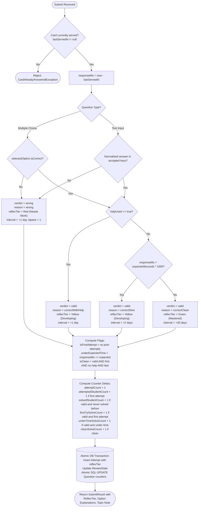

# Reflex: Competition Engineering Standards & Architectural Blueprint (v2.1)

> **Application Name:** **Reflex**  
> **Document Version:** 2.1.0  
> **Target Date:** October 8 – October 14, 2026 (Serverpod Hackathon Deadline)  
> **Scope:** Clean Practice Loop + Chromatic Reflex Feedback (Green/Yellow/Red) + MCQ & Option Explanations + Post-Submission Topic Note Gate + Help Tracking + Question Counters + Flutter MVVM + Serverpod CSR + Sentry + easy_localization + TDD

---

## 1. Executive Architectural Opinion & Evaluations

You requested evaluations for:
1. **Naming the application Reflex**
2. **Chromatic Reflex Feedback:** Answer backgrounds and cards reflecting student mastery level (Red for wrong, Yellow for valid but slow/helped, Green for valid and fast)
3. **Multiple-Choice Questions (MCQ) with per-option explanations** showing why each choice is right or wrong
4. **Flutter MVVM + Serverpod Controller-Service-Repository (CSR) + Sentry + easy_localization + TDD**

---

### 1.1 Assessment of Chromatic Reflex Feedback (Red / Yellow / Green)
* **Verdict:** **Outstanding & Strongly Endorsed.**
* **Why this is a game-changer for "Reflex":**
  1. **Immediate Dopamine & Cognitive Conditioning:** In speed-recall and spaced repetition (e.g. Quantic, SuperMemo, Duolingo), feedback latency is the enemy of retention. Associating instant, distinct chromatic colors with recall performance reinforces the mind:
     - 🟢 **Emerald Green (`#10B981`) = "Reflex Mastered":** Clean solve (fast, accurate, no help, 1st attempt). Promoted to $+30$ day interval.
     - 🟡 **Amber Yellow (`#F59E0B`) = "Reflex Developing":** Correct answer, but cognitive hesitation detected ($> \text{expectedSeconds}$ or help used). Scheduled for $+2$ days (slow) or $+1$ day (helped).
     - 🔴 **Crimson Red (`#EF4444`) = "Reflex Needs Work":** Inaccurate answer. Scheduled for immediate reinforcement ($+1$ day, lapses $+1$).
  2. **Cohesive Product Identity:** The application is called **Reflex**. The color scheme directly answers the question: *"Is this student's reflex lightning-fast and accurate, or developing?"*
  3. **Accessibility Recommendation:** To support colorblind users (deuteranopia/protanopia), pair the chromatic color with a clear icon and text badge:
     - 🟢 `⚡ Fast & Clean (+30d)`
     - 🟡 `⏳ Developing (+2d)` or `💡 Assisted (+1d)`
     - 🔴 `❌ Needs Practice (+1d)`

---

### 1.2 Assessment of Multiple-Choice (MCQ) & Per-Option Explanations
* **Verdict:** **Strongly Approved & Essential for Modern Learning.**
* **Why per-option explanations elevate the learning loop:**
  - Traditional apps only say "Option B is correct". Students are left wondering *why* their chosen distractor was wrong.
  - Providing an **explanation note per option** (e.g., *"Why Choice A is incorrect: It confuses momentum with kinetic energy"*) transforms wrong answers from frustrating dead-ends into high-value micro-lessons.
* **Security & Zero-Leakage Architecture:**
  - When serving `QuestionView` to the student, the options list (`QuestionOptionView`) **strictly contains only `id` and `text`**.
  - `isCorrect` and `explanation` are **never transmitted** before submission.
  - Only upon `submitAnswer` does the server return `SubmitResult` containing `optionExplanations: List<OptionExplanationView>` and `selectedOptionExplanation: String?`.

---

## 2. Reflex Domain Models & PostgreSQL Schema

### 2.1 Entity Model (`.spy.yaml`)

```yaml
# question.spy.yaml
class: Question
table: question
fields:
  courseId: int
  position: int
  prompt: String
  topic: String
  questionType: QuestionType  # textInput | multipleChoice
  points: int
  expectedSeconds: int
  topicNote: String?
  helpHint: String?
  # Aggregate Question Counters
  attemptCount: int
  attemptedStudentCount: int
  solvedStudentCount: int
  firstTrySolveCount: int
  underTimeSolveCount: int
  cleanSolveCount: int
```

```yaml
# question_option.spy.yaml
class: QuestionOption
table: question_option
fields:
  questionId: int
  position: int
  text: String
  isCorrect: bool
  explanation: String?  # Explains why this choice is right or wrong
indexes:
  question_option_qid_idx:
    fields: questionId
```

```yaml
# attempt.spy.yaml
class: Attempt
table: attempt
fields:
  learnerId: int
  questionId: int
  selectedOptionId: int?   # Null for text input questions
  answerText: String?         # Null for multiple choice questions
  status: AttemptStatus       # valid | wrong
  responseMs: int
  usedHelp: bool
  isFirstAttempt: bool
  underExpectedTime: bool
  isClean: bool
  reflexTier: ReflexTier      # greenMastered | yellowDeveloping | redNeedsWork
  createdAt: DateTime
```

---

## 3. The Reflex Mastery Decision Matrix



---

## 4. Flutter MVVM Architecture & Chromatic UI State

### 4.1 State Hierarchy
```dart
sealed class PracticeUiState {}

class Loading extends PracticeUiState {}

class QuestionShown extends PracticeUiState {
  final QuestionView question;
  final int? selectedOptionId;
  final String? typedAnswer;
  QuestionShown({required this.question, this.selectedOptionId, this.typedAnswer});
}

class ResultShown extends PracticeUiState {
  final SubmitResult result;
  final ReflexTier reflexTier; // greenMastered | yellowDeveloping | redNeedsWork
  final bool noteAcknowledged;
  ResultShown({
    required this.result,
    required this.reflexTier,
    this.noteAcknowledged = false,
  });
}

class DeckComplete extends PracticeUiState {}

class Failure extends PracticeUiState {
  final String message;
  Failure(this.message);
}
```

### 4.2 Dynamic Chromatic Aura & Explanation Display
When `state is ResultShown`:
1. **Background Aura / Tint:**
   * 🟢 `ReflexTier.greenMastered` $\to$ Container animated to soft emerald background (`Color(0xFFE8F5E9)`), border `#10B981`.
   * 🟡 `ReflexTier.yellowDeveloping` $\to$ Container animated to soft amber background (`Color(0xFFFFFBEB)`), border `#F59E0B`.
   * 🔴 `ReflexTier.redNeedsWork` $\to$ Container animated to soft coral background (`Color(0xFFFEF2F2)`), border `#EF4444`.
2. **Option Explanation Card:**
   * For MCQ questions, shows the student's selected choice highlighted.
   * Renders the rationale: *"Why this choice is right / wrong: ..."*.
   * Highlights the correct option in green if the student selected a wrong option.
3. **Topic Note Gate:**
   * Shows teacher's broad `topicNote`.
   * The "Continue to Next Card" button is **disabled** until the student taps **"✓ I have read the explanation and note"**.

---

## 5. Serverpod Clean Architecture (CSR Pattern)

```
Endpoint (Thin Controller)
   │  Checks scopes, validates auth session (< 25 lines)
   ▼
Service Layer (Pure Domain Logic - 100% Unit Tested)
   │  PracticeService, Grader (MCQ & Text), AttemptOutcomeCalculator
   ▼
Repository Layer (Data Access & Atomic SQL)
   │  QuestionRepo, OptionRepo, AttemptRepo, ReviewStateRepo
   ▼
PostgreSQL Database
```

---

## 6. Monorepo Project Layout

```
education_saas/  (App: Reflex)
├── AGENTS.md                          # Guidelines for AI models
├── README.md                          # Hackathon overview & quickstart
├── ARCHITECTURE.md                    # This document
├── tool/
│   ├── check.sh                       # Lint, analyze, and test runner
│   └── smoke_test.dart                # Production API validation script
├── reflex_server/                     # Serverpod Backend Package
│   ├── lib/src/
│   │   ├── domain/                    # Pure domain logic (TDD)
│   │   │   ├── grader.dart            # Evaluates text & MCQ options
│   │   │   ├── attempt_outcome.dart   # Computes ReflexTier & counters
│   │   │   ├── card_selector.dart     # Selects overdue/new cards
│   │   │   └── scheduling_policy.dart # Fixed interval calculations
│   │   ├── models/                    # .spy.yaml definitions (Question, Option, Attempt...)
│   │   ├── repositories/              # DB repositories with atomic SQL
│   │   └── endpoints/                 # Thin controllers (Practice, Dashboard, Questions)
├── reflex_client/                     # Generated Serverpod client
└── reflex_flutter/                    # Flutter MVVM Application
    ├── assets/translations/           # en.json, ar.json
    ├── lib/
    │   ├── core/                      # MVVM Command, Result, Sentry, Router
    │   ├── data/                      # Repositories wrapping Serverpod client
    │   ├── l10n/                      # Generated LocaleKeys
    │   └── ui/                        # Views & ViewModels
    │       ├── practice/              # PracticeView, MultipleChoiceWidget, NoteGateWidget
    │       ├── dashboard/             # Topic mastery, Chromatic distribution, Question insights
    │       └── teacher_notes/         # Topic notes and option explanations editor
```

---

## 7. 14 Verified UML Diagrams

All 14 diagrams have been updated with Reflex branding, MCQ models, option explanations, and chromatic feedback, and rendered to `docs/competition/uml/`:

| # | Diagram | Kind | File Link |
|---|---|---|---|
| 01 | Use Case (Teacher & Student) | `usecase` | [01_use_case.png](file:///Users/ahmedhassan/Documents/Ahmed/Engineering/Flutter/Education-App/docs/competition/uml/01_use_case.png) |
| 02 | System & Component Architecture | `component` | [02_component_architecture.png](file:///Users/ahmedhassan/Documents/Ahmed/Engineering/Flutter/Education-App/docs/competition/uml/02_component_architecture.png) |
| 03 | Domain Class Diagram (MCQ, Options, ReflexTier) | `class` | [03_class_domain.png](file:///Users/ahmedhassan/Documents/Ahmed/Engineering/Flutter/Education-App/docs/competition/uml/03_class_domain.png) |
| 04 | Serverpod Layers (CSR Pattern) | `class` | [04_class_server_layers.png](file:///Users/ahmedhassan/Documents/Ahmed/Engineering/Flutter/Education-App/docs/competition/uml/04_class_server_layers.png) |
| 05 | PostgreSQL ER Diagram (with question_option) | `er` | [05_er_diagram.png](file:///Users/ahmedhassan/Documents/Ahmed/Engineering/Flutter/Education-App/docs/competition/uml/05_er_diagram.png) |
| 06 | Next Card Request Flow (MCQ or Text) | `sequence` | [06_sequence_next_card.png](file:///Users/ahmedhassan/Documents/Ahmed/Engineering/Flutter/Education-App/docs/competition/uml/06_sequence_next_card.png) |
| 07 | Need Help & Hint Reveal Flow | `sequence` | [07_sequence_request_help.png](file:///Users/ahmedhassan/Documents/Ahmed/Engineering/Flutter/Education-App/docs/competition/uml/07_sequence_request_help.png) |
| 08 | Submit Answer, Chromatic Feedback & Explanations | `sequence` | [08_sequence_submit_answer.png](file:///Users/ahmedhassan/Documents/Ahmed/Engineering/Flutter/Education-App/docs/competition/uml/08_sequence_submit_answer.png) |
| 09 | Card Review State Machine | `state` | [09_state_machine_card.png](file:///Users/ahmedhassan/Documents/Ahmed/Engineering/Flutter/Education-App/docs/competition/uml/09_state_machine_card.png) |
| 10 | Reflex Attempt Outcome & Chromatic Classifier | `activity` | [10_activity_outcome_and_counters.png](file:///Users/ahmedhassan/Documents/Ahmed/Engineering/Flutter/Education-App/docs/competition/uml/10_activity_outcome_and_counters.png) |
| 11 | Teacher Analytics & Chromatic Distribution | `sequence` | [11_sequence_dashboard.png](file:///Users/ahmedhassan/Documents/Ahmed/Engineering/Flutter/Education-App/docs/competition/uml/11_sequence_dashboard.png) |
| 12 | Flutter MVVM Architecture & Chromatic UI State | `class` | [12_class_flutter_mvvm.png](file:///Users/ahmedhassan/Documents/Ahmed/Engineering/Flutter/Education-App/docs/competition/uml/12_class_flutter_mvvm.png) |
| 13 | Post-Submission Explanations & Topic Note Gate | `sequence` | [13_sequence_submit_note_gate.png](file:///Users/ahmedhassan/Documents/Ahmed/Engineering/Flutter/Education-App/docs/competition/uml/13_sequence_submit_note_gate.png) |
| 14 | Reflex Sentry Error Telemetry Flow | `sequence` | [14_sequence_error_reporting.png](file:///Users/ahmedhassan/Documents/Ahmed/Engineering/Flutter/Education-App/docs/competition/uml/14_sequence_error_reporting.png) |
